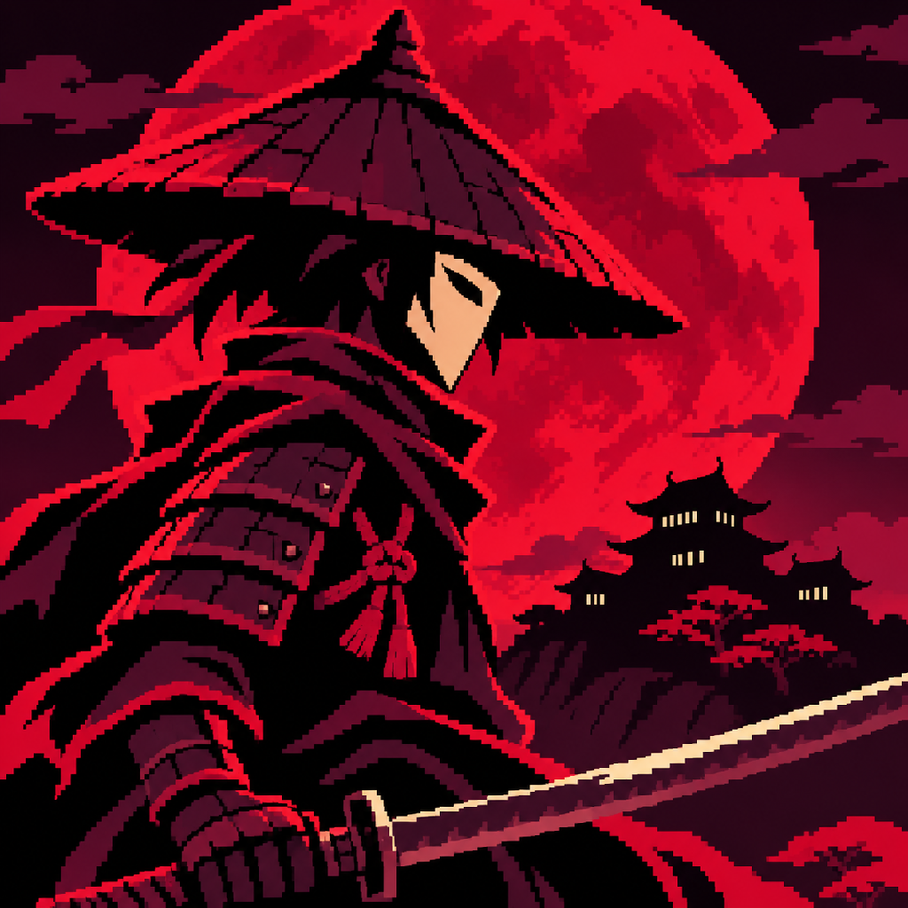

  
Latest combat/UI pass: [four-cut combo, slide/drop, blood feedback, enemy health and campaign atlas](docs/COMBAT_MAP_PASS.md).

# Ashen Veil

Godot4.7 landscape samurai action prototype: 100 modular monastery/castle routes, pixel-art environments and cel characters, moving platforms, separate health/power, and keyboard/touch controls.

Open `game/project.godot`, or run `/Applications/Godot.app/Contents/MacOS/Godot --path game -- --touch-preview`.

## Assets

[Asset catalog](assets/README.md) lists character poses, enemies, VFX, environments, audio, and archived art passes.

## Current build

[Vertical routes, comparable games, new architecture and Ash Tengu](docs/research/VERTICAL_LEVEL_REBUILD.md) describes the latest layout/art pass and supersedes the earlier flat campaign layouts.

[100-level campaign, rewards, boss skills and validation](docs/CAMPAIGN_100.md) is the current progression specification: ten chapters, major bosses every ten levels, physical pickups and a level20 beam upgrade. Earlier ten-level notes below are historical.

[Current level redesign and primary references](docs/research/LEVEL_REDESIGN.md): ten authored routes with climbs, staged descents, recovery decks and bosses on routes 5 and 10. Route data lives in `game/data/routes.json`.

Red-and-ivory image-generated menu components and controls, stateful toggle artwork, a real persisted volume meter, nested settings with icons, and distinct start/pause/defeat context. Touch settings support size, handedness, opacity and vibration; privacy links are configured in `game/config/privacy.cfg`.

Guard, fire keeper and floating oni mask use whole-character pixel cels. Lancer and hammer sentinel add longer-reach and heavier telegraphed attacks. Platforms use matching dark stone/red moss art. The camera is25percent closer with eased look-ahead, a vertical jump window, and zoom-aware boundaries. Damage feedback is crimson; projectile contact emits once. Player/enemy footsteps and power/ranged/energy sound roles are distinct.

A/D moves; Space jumps/double-jumps; J taps sword combos or holds/releases charge; DOWN+J deliberately plunges; L kicks; U uses power; I fires a blade; X fires an energy slash; K or a directional double-tap dashes; E enters an unlocked shrine; Escape pauses. Mobile uses the left directional cross and right combat cluster.

[Current pixel-art pass](docs/PIXEL_STYLE_PASS.md) · [Menu components](docs/PIXEL_MENU_COMPONENTS.md) · [Enemy redraw](docs/PIXEL_ENEMY_REDRAW.md) · [181-source library](docs/research/SOURCE_LIBRARY.md) · [Story](docs/STORY.md)

Menu cleanup adds stable-height scrolling settings rows, flat switch styling, and a landscape title screen with artwork left/actions right. A generated pixel START banner and app icon are included. [Cleanup notes](docs/MENU_AND_MOVEMENT_CLEANUP.md).

Ashen Veil adds a separate animated welcome illustration, optional chapter text, quiet hover states, opacity guidance, a square-primary/circular-power touch cluster, faster jump tracking and tapered energy/kick feedback. [Pass notes and iOS evidence boundary](docs/ASHEN_VEIL_PASS.md).

Decorative barrel/crate/shrine scenery, directional impact alignment, roomier action rows, transient click feedback and custom crimson scrollbars are documented in [scenery/UI pass](docs/SCENERY_RECOIL_UI_PASS.md).

Combat motion sounds now lead the authored contact by their measured recording envelope; landing, air-jump and impact transients start more promptly. [Timing, research, tests and listening samples](docs/MOTION_AUDIO_SYNC.md).

Attack resources now use new CC0 swishes and role-specific layered contacts, plus separate pixel cels for sword arcs, sparks, criticals, ground waves and energy bolts. [Resource mappings, sources and sample](docs/ATTACK_RESOURCE_REPLACEMENT.md).

Rapid taps now chain after active frames; stronger cuts have a ground-clearing half-shell, shared mass/poise recoil, planted-foot idle breathing, and ground contact layers from two additional creators. [Global rules, formula, configuration and evidence](docs/GLOBAL_COMBAT_RULES.md).

Katana-specific source research and revised shared button metrics fix the inflated defeat action, align menu padding, and reflow touch settings into responsive columns. [Research, licenses, review and evidence](docs/SAMURAI_AUDIO_BUTTON_REVIEW.md).

## Limits

The hero's idle/first sword/kick use the new redraw; several other actions remain normalized source compatibility art. Enemy animation is a sparse key-pose set. Physical-phone comfort/performance and subjective motion/audio approval remain pending. A60FPS capture does not mean60unique drawings per second. Rams UI checks were requested but blocked by exhausted credits.

Restricted original pack artwork and licensed composer music must remain under their distribution terms. No paid assets/applications were purchased. Historical captures describe earlier builds; the current notes above take precedence.
